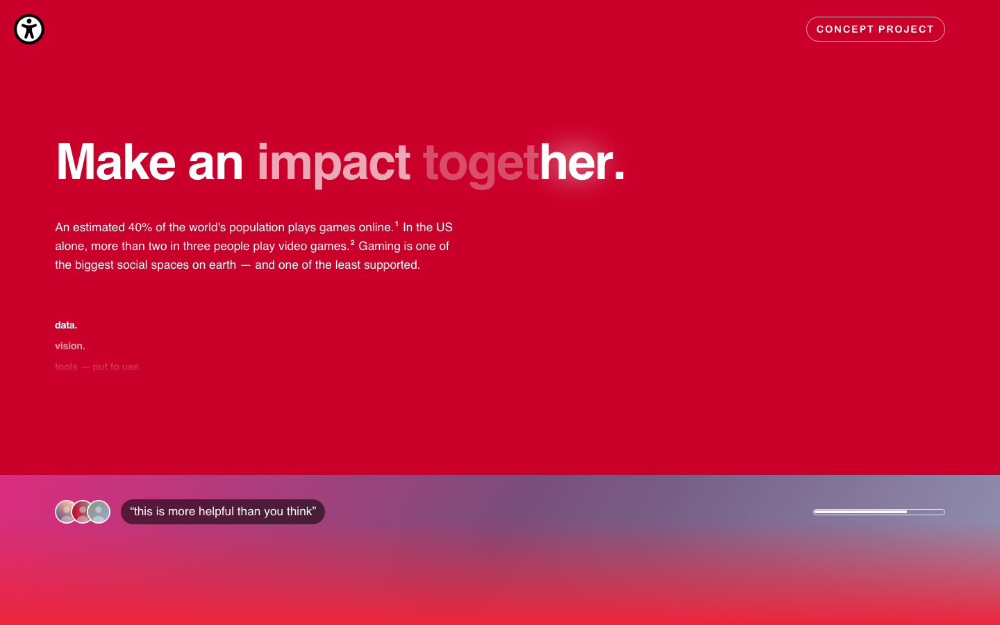
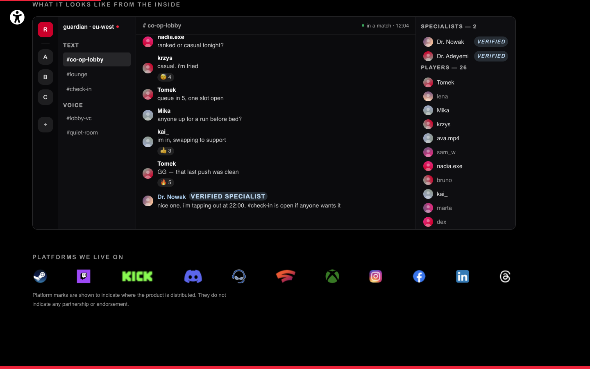
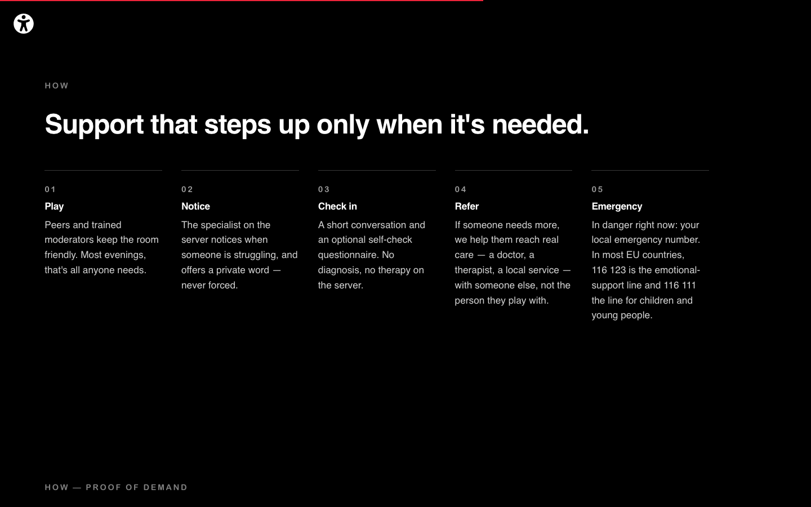

# reh.ab — Make an impact together

**A concept for mental-health support inside gaming communities.**
Guardian servers: ordinary places to play, with a psychologist or psychiatrist who
actually plays present by design, and a clear path from "this is a hard week" to
real care.

**Live page:** https://lumerw.github.io/reh.ab/

> Concept project. Not a live service: every person, credential and conversation in
> the mockups is fictional.



## The idea in four steps

1. **Need.** More than a billion people live with a mental-health condition, and even in
   higher-income countries only about half get care (WHO, 2025).
2. **Reach.** About 40% of the world plays games online. Many of the people who need
   support already spend their evenings there.
3. **Insight.** Hours played don't predict harm. *Why* people play does: feeling you
   have to play goes with worse wellbeing, wanting to play doesn't (Oxford, 2022).
   Heavy play is often a way of coping with something else.
4. **Response.** Put a specialist where people already are. They don't run therapy
   in the game: they notice, check in and refer, with support that steps up only
   when it's needed.

Every number on the page links to its source in the **Research & sources** drawer.

| What it looks like inside | Stepped support |
|---|---|
|  |  |

## What I did

Concept, research, copy, visual and motion design, and front-end.

- **One static page** with no build step or framework: `index.html`, `css/style.css`,
  `js/main.js`.
- **Design system in tokens:**
  - a five-step type scale;
  - one easing curve and one family of durations;
  - one shared corner slot for every animated mark.
- **A working, data-driven chat mockup.** The servers, channels, people and profile
  dialog come from plain data objects, and the panel is keyboard-operable with a
  focus trap.
- **Motion:**
  - a looping SVG morph (two loops closing into a heart);
  - a canvas waveform with trailing frames;
  - SOS in real Morse code;
  - seamless logo marquees timed to equal px/second.

## Accessibility

Built to **WCAG 2.2 AA**:
- skip link, landmarks, live regions;
- 44px targets and a two-tone focus ring;
- status shown without colour.

An on-page panel turns motion off, raises contrast and changes text size, and it
remembers the choice. Contrast was measured rather than guessed. One known gap is
documented on the page: white body text on the bright red reaches 4.24:1. High
contrast mode fixes it.

The page also works without JavaScript, and YouTube is click-to-load from
`youtube-nocookie.com`.

## Run it locally

```bash
python3 -m http.server 4173
```

Then open http://localhost:4173.

## Assets and licences

- **Code:** MIT (see `LICENSE`).
- **Copy, design and graphics:** © Wojciech Lumer, all rights reserved.
- **Fonts:** none are bundled. The page uses the system Helvetica (macOS/iOS) or
  Arial.
- **Portraits and video clips:** the author's local build uses licensed stock footage,
  which is not in this repository. The published page shows abstract placeholders
  instead (`assets/placeholder/`).
- **Third-party logos** appear only as cited sources or as the platforms the concept
  would run on. None of these organisations is affiliated with or endorses the project,
  and that includes Dr. Alok Kanojia and Healthy Gamer, who are named as inspiration
  only.
